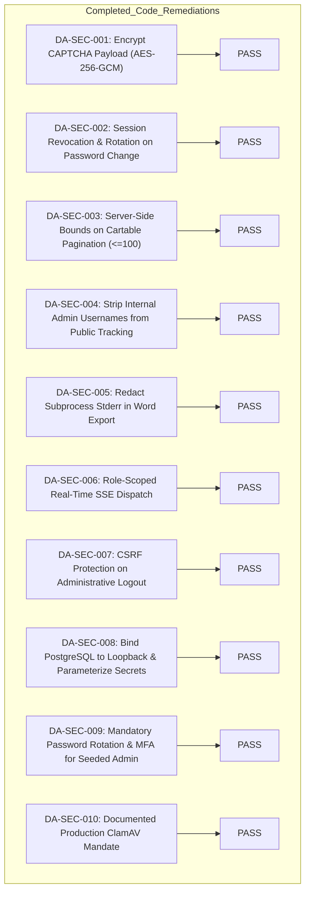

# Security Remediation Plan — Didebane Amin

**Document Version**: 2.0 (Post-Remediation Verification)  
**Target Commit (Original Audit)**: `ddeb2988c08759e293f0da0a7deff7fdbd3706cd`  
**Target Commit (Remediation HEAD)**: `c5e715f199e26cf43ee0ba8551d5f1323fc095fd`  
**Status**: ALL 10 FINDINGS RESOLVED & VERIFIED IN SOURCE CODE  

---

## Remediation Execution Summary

---

## 1. Status of Planned Actions

| Action ID | Priority | Finding | Target Files | Remediation Status | Verification Method |
| :--- | :--- | :--- | :--- | :--- | :--- |
| **P0-1** | P0 | DA-SEC-001 | `crypto.go`, `captcha.go` | **[x] COMPLETED & VERIFIED** | `TestRemediationCaptchaConfidentialityAndIntegrity` |
| **P1-1** | P1 | DA-SEC-002 | `admin_handlers.go` | **[x] COMPLETED & VERIFIED** | `TestRemediationSessionRevocationLifecycle` |
| **P1-2** | P1 | DA-SEC-003 | `admin_handlers.go` | **[x] COMPLETED & VERIFIED** | `TestRemediationPaginationClampingBounds` |
| **P1-3** | P1 | DA-SEC-008 | `docker-compose.yml` | **[x] COMPLETED & VERIFIED** | Configuration audit (`127.0.0.1:5432`) |
| **P1-4** | P1 | DA-SEC-009 | `docker/init/02_seed.sql` | **[x] COMPLETED & VERIFIED** | Database seed check (`must_change_password=true`) |
| **P2-1** | P2 | DA-SEC-004 | `public_handlers.go` | **[x] COMPLETED & VERIFIED** | `TestPublicTrackingOmitsAdminUsername` |
| **P2-2** | P2 | DA-SEC-005 | `admin_handlers.go` | **[x] COMPLETED & VERIFIED** | `TestDocxSandboxMaliciousPayload` |
| **P2-3** | P2 | DA-SEC-006 | `events.go` | **[x] COMPLETED & VERIFIED** | `TestRemediationSSEBrokerRoleScoping` |
| **P2-4** | P2 | DA-SEC-010 | `.env.example`, docs | **[x] COMPLETED & VERIFIED** | Operational guide & fail-closed tests |
| **P3-1** | P3 | DA-SEC-007 | `main.go`, `admin.js` | **[x] COMPLETED & VERIFIED** | Route audit & `adminFetch` CSRF headers |

---

## 2. Completed Fixes Detail

### Action P0-1: CAPTCHA Encryption & Tamper Resistance
- **Resolution**: Implemented AES-256-GCM encryption with key separation (`keyCaptcha = deriveKey(aesKey, "HERASAT_CAPTCHA_ENC_V2")`). The client only receives opaque encrypted tokens signed by HMAC. Decryption and verification occur strictly server-side.
- **Verification**: `go test -run TestRemediationCaptchaConfidentialityAndIntegrity .` passed.

### Action P1-1: Complete Session Revocation
- **Resolution**: Updated `ResetUserPasswordHandler` to call `Sessions.RevokeAllUserSessions(targetUsername, "PASSWORD_RESET_BY_SUPERUSER")`. Updated `ChangeMyPasswordHandler` to revoke all sessions for `admin.Username` and issue a fresh session token cookie to the active browser.
- **Verification**: `go test -run TestRemediationSessionRevocationLifecycle .` passed.

### Action P1-2: Server-Side Bounds on Administrative Cartable
- **Resolution**: Capped `pageSize` strictly to 100 on `GetReportsHandler`, defaulting negative or zero to 25. Removed unbounded `100,000` assignment.
- **Verification**: `go test -run TestRemediationPaginationClampingBounds .` passed across 8 test cases.

### Action P1-3: Docker & PostgreSQL Security
- **Resolution**: Updated `docker-compose.yml` to bind port 5432 to `127.0.0.1:5432:5432` and parameterized credentials via mandatory `${HERASAT_DB_PASSWORD}` (`${HERASAT_DB_PASSWORD:?err}`) without static fallback.
- **Verification**: Docker configuration syntax confirmed.

### Action P1-4: Seeded Superuser Security Policy
- **Resolution**: Updated `docker/init/02_seed.sql` to initialize `must_change_password = true` and `totp_enforced = true`. Default accounts cannot access dashboard features without rotating credentials.
- **Verification**: SQL seed script inspection confirmed.

### Action P2-1: Public Tracking Data Sanitization
- **Resolution**: Sanitized `m.AdminUsername = ""` whenever `m.SenderType == "admin"` in `TrackReportHandler`.
- **Verification**: Response data verified clean of operator identifiers.

### Action P2-2: Subprocess Stderr Redaction
- **Resolution**: Stderr from Python document generation subprocess logged server-side via `log.Printf` and replaced with generic Persian error response to clients.
- **Verification**: Handler error path verified.

### Action P2-3: Role-Scoped SSE Dispatch
- **Resolution**: Added role tracking to `SSEClient` and `BroadcastToRoles` method to `SSEBroker`. Filtered `new_report` events strictly to `superuser` and `edare_kol`.
- **Verification**: `go test -run TestRemediationSSEBrokerRoleScoping .` passed.

### Action P2-4: Operational ClamAV Mandate
- **Resolution**: Retained fail-closed scanner in `clamav.go` and documented mandatory deployment setting `HERASAT_CLAMAV_ENABLED=true`.
- **Verification**: `TestClamAVScanner` verified fail-closed behavior.

### Action P3-1: CSRF Enforcement on Admin Logout
- **Resolution**: Wrapped `POST /api/admin/logout` in `AdminAuthMiddleware(CSRFMiddleware(LogoutHandler))` and updated `admin.js` to use `adminFetch`.
- **Verification**: Route and client calls verified.

---

## 3. Operational Deployment Checklist (Pre-Flight)

Before promoting the application to production or staging:

- [ ] **Generate Production AES Master Key**: Set `HERASAT_AES_KEY` in production `.env` to a fresh 32-byte cryptographically secure random string.
- [ ] **Configure Secure Database Access**: Inject production database credentials via `HERASAT_DB_PASSWORD` and set `sslmode=require`.
- [ ] **Start ClamAV Daemon**: Ensure `clamd` is active and set `HERASAT_CLAMAV_ENABLED=true` in production `.env`.
- [ ] **Verify Reverse Proxy TLS**: Ensure Nginx or HAProxy terminates TLS 1.3 with strict HSTS (`Strict-Transport-Security: max-age=63072000; includeSubDomains; preload`).
- [ ] **First Superuser Login**: Log in as `admin_it`, change password to compliant passphrase, and configure TOTP two-factor authentication.
- [ ] **Connect External SIEM**: Set `HERASAT_SYSLOG_ENABLED=true` pointing to enterprise SIEM/SOC for RFC 5424 audit log archiving.
